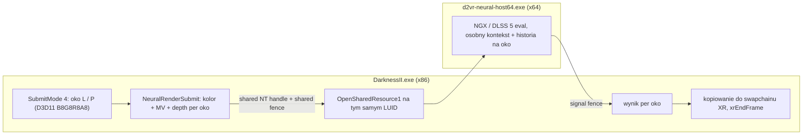

# Plan: DLSS 5 Neural Rendering w Darkness2VR (wersja 2, po weryfikacji)

**Task ID**: `dlss5-neural-render`
**Autor**: SIDE (analiza offline, 2026-11-01)
**Wykonawca runtime**: MAIN (Steam, gogle, deploy)
**Status**: PLAN — nic nie zaimplementowano, nic nie wdrożono
**Zastępuje**: wersję 1 tego pliku (błędne założenia, patrz sekcja 7)

---

## 1. Fakty zweryfikowane

### Sprzęt
- GPU: **NVIDIA GeForce RTX 5070** (sterownik 32.0.16.2101) — DLSS 5 wymaga serii RTX 50, więc sprzętowo jest OK.
- W systemie jest też **AMD Radeon iGPU** → host x64 musi otworzyć urządzenie na **tym samym adapterze (LUID)** co nasze `g_dev11`, inaczej współdzielenie tekstur nie zadziała.

### Czym jest DLSS 5
- To **neuronowy etap renderowania** (oświetlenie, materiały, skóra/włosy) na końcu potoku, **a nie upscaler**. Koszt GPU jest **dodatkowy**: DLSS 5 nie przyspiesza gry, tylko ją spowalnia.
- Wejścia w runtime: kolor, **wektory ruchu z silnika**, historia czasowa i parametry stylu. Głębia/normalne służą głównie do treningu modelu (wg NVIDIA, do potwierdzenia w SDK/addonie).

### DLSS5-Feeder (społecznościowy)
- Oparty na ReShade. Dla gier 32-bit: `dlss5-feed.addon32` w grze + osobny proces **`host64\dlss5-feed-host64.exe`** z 64-bitowym ReShade, `renodx-dlss5.addon64`, `nvngx_dlssnr.dll` i `nvngx_dlss.dll`.
- Dla DX9 zakłada dgVoodoo2/DXVK + ReShade jako `d3d9.dll`/`dxgi.dll`.

### Nasz kod (`.side-shouldrender-fix`, commit 2dae9c34)
| Element | Stan faktyczny |
|---|---|
| OpenXR | **W procesie x86 gry**: `xrCreateSession` d3d9.cpp:5137, `xrEndFrame` d3d9.cpp:6004 |
| D3D11 | W procesie x86: `g_dev11` (d3d9.cpp:1423), `D3D11CreateDevice` d3d9.cpp:5124 |
| Mostek x64 | `src/psvr2/BridgeMain.cpp`: **tylko** triggery/gaze PSVR2, jednokierunkowy pipe (`PIPE_ACCESS_INBOUND`). **Nie przesyła żadnych tekstur.** |
| Głębia | `g_intzTex9` (INTZ/RAWZ/DF24 latched, d3d9.cpp:2484–2556), kopiowana do **480×270** `g_depthSRV11`. Pełnej rozdzielczości per-oko brak. |
| Wektory ruchu | Brak bufora. Jest shader MotionBlur **VS 73EBA724** (c0 = bieżące WVP, c4 = PrevWorldProj) i flaga `FixMotionVectorProjection` (d3d9.cpp:801). Nie wiadomo, do jakiego RT/formatu pisze. |
| Punkt wstawienia | `NisEyeProcess()` w `src/nis_eye.inl`: obie tekstury oczu `B8G8R8A8_UNORM` przed końcową kopią do swapchainu XR. Wzorzec ze sticky fallback już istnieje. |

---

## 2. Konsekwencje architektoniczne

1. **NGX nie załaduje się w procesie gry** (x86). Warstwa API OpenXR też byłaby x86, bo ładuje ją loader w procesie gry. Jedyna droga to **osobny proces x64** i tekstury współdzielone między procesami.
2. **ReShade-Feeder w obecnej formie nie pasuje**: ReShade jako `d3d9.dll` koliduje z naszym proxy. Widziałby też tylko płaski mirror, a nie dwa obrazy oczu.
3. Realny kształt rozwiązania:



- Synchronizacja tylko po stronie GPU: `ID3D11Fence` współdzielony, `ID3D11DeviceContext4::Wait/Signal`. Bez blokowania CPU (wątek renderu już jest wąskim gardłem).
- Transfer: zero kopii, oba procesy widzą te same zasoby.

---

## 3. Główne ryzyka (od nich zależy, czy w ogóle warto)

| # | Ryzyko | Dlaczego to ważne w VR |
|---|---|---|
| R1 | **Niespójność stereo**: model generatywny może inaczej „dorysować” detale w L i P | Rywalizacja obuoczna i dyskomfort. Problem nieobecny na płaskim ekranie. |
| R2 | **Budżet 11,1 ms przy 90 Hz** dla 2 × ~2676×2728 (~14,6 MP), a koszt jest *dodatkowy* | Gra już jest CPU-bound. Jeśli GPU przekroczy budżet, wpadamy w reprojekcję 45 Hz. |
| R3 | **Brak prawdziwych MV** (animowane macki, wrogowie, cząsteczki) | Smużenie i „pływanie” nowego oświetlenia na ruchomych obiektach |
| R4 | **Styl komiksowy**: model fotorealistyczny może zniszczyć cel-shading | Ocena estetyczna przed jakąkolwiek integracją |
| R5 | Licencje: NGX DLL nie wolno commitować; licencja Feedera/RenoDX nieznana | Pliki dostarcza użytkownik, a kod można zapożyczyć dopiero po sprawdzeniu licencji |
| R6 | Opóźnienie cross-process (planowanie GPU między dwoma kontekstami) | Każda dodatkowa klatka opóźnienia jest odczuwalna w goglach |

---

## 4. Etapy z bramkami (kill gates)

Każdy etap kończy się decyzją GO/STOP. Etapy 0–2 są **offline** (może je robić SIDE), etapy 3–5 to **MAIN** (runtime/Steam).

### Etap 0: rozpoznanie źródeł (offline, SIDE)
1. Pobrać repozytorium DLSS5-Feeder i `renodx-dlss5`, sprawdzić licencje.
2. Ustalić **faktyczne API**: który feature NGX/Streamline wywołuje addon, jakie zasoby i parametry przekazuje (MV w pikselach czy NDC, skala, jitter, reset historii, intensywność).
3. Sprawdzić, czy `dlss5-feed-host64.exe` ma udokumentowany protokół IPC przyjmujący zewnętrzne shared handles. Jeśli tak, rozważyć ponowne użycie zamiast własnego hosta.
4. **Wynik**: `docs/research/dlss5-api-recon.md` z cytatami z kodu (nazwy funkcji, struktury) i decyzją „własny host vs reuse”.
- **STOP**, jeśli licencja zabrania lub API wymaga zasobów, których nie możemy dostarczyć.

### Etap 1: test kosztu i jakości na nieruchomych klatkach (offline, SIDE)
1. Minimalny `tools/neural-host64/` (x64, D3D11): ładuje NGX z katalogu podanego przez użytkownika (DLL **poza Gitem**).
2. Wejście: istniejące prywatne zrzuty z matched capture (RT0/final-eye, `docs/research/matched-frame-capture.md`), z MV = 0 jako dolną granicą.
3. Pomiar: ms GPU (timestampy, jak w `nis_runtime.h`) dla 1 oka przy natywnej rozdzielczości oka i przy profilu `5k90-scaled` (2048×2091).
4. Porównanie wizualne L/P: `test/pair_diff.py` / `test/eye_diff.py` na wyjściu vs wejściu (metryka R1).
- **GO**, jeśli para oczu ≤ ~4 ms GPU przy wybranej rozdzielczości, styl jest akceptowalny dla użytkownika i różnica L/P nie rośnie istotnie względem wejścia.
- **STOP** w przeciwnym razie. Wtedy zostajemy przy NIS + foveated sharpening.

### Etap 2: interop x86↔x64 (offline, SIDE; fixture jak testy NIS/WARP)
1. Testowy exe x86 tworzy 2 tekstury oczu z `D3D11_RESOURCE_MISC_SHARED_NTHANDLE`, współdzielony `ID3D11Fence` i wybiera adapter po LUID RTX 5070.
2. Host x64 otwiera je przez `OpenSharedResource1`/`OpenSharedFence`, przetwarza i sygnalizuje.
3. Testy: poprawność pikseli w obu kierunkach, 1000 cykli, zabicie hosta w trakcie (fixture **musi** przejść na fallback bez zawieszenia GPU-wait, z timeoutem), restart hosta, zła karta (iGPU) → odmowa.
- **GO**, jeśli dodatkowe opóźnienie round-trip mieści się w tej samej klatce i fallback jest deterministyczny.

### Etap 3: dane wejściowe w grze (MAIN, runtime; zasada „evidence before patch”)
1. **Głębia**: pełna rozdzielczość per oko z `g_intzTex9` w replay SubmitMode 4 (dziś tylko 480×270, jeden snapshot). Udokumentować, kiedy w replayu prawego oka INTZ zawiera głębię prawego oka.
2. **MV**: RE shadera MotionBlur 73EBA724: jaki RT, format i rozdzielczość, czy obejmuje skinned meshes. Dowód: adresy, hash shadera, zrzut RT z matched capture. Jeśli to tylko motion blur kamery, MV dla obiektów pozostają ryzykiem R3.
3. Fallback dla MV: rekonstrukcja z głębi + macierzy kamery per oko (bieżące/poprzednie z naszego toru stereo, `stereo_geometry.h`). Działa dla statycznej sceny, ale nie dla animacji.
- Bez dowodów **nie** wolno zgadywać rejestrów ani offsetów.

### Etap 4: integracja (SIDE implementuje, MAIN buduje i wdraża)
1. Nowy `src/neural_render.inl` obok `nis_eye.inl`, wywoływany w tym samym miejscu. Wyłączność: albo NIS, albo neural, nigdy oba bez decyzji.
2. Klucze INI (**propozycja**, domyślnie wyłączone):
   ```ini
   [Render]
   NeuralRender=0              ; 0=off (NIS jak dziś), 1=DLSS 5 przez host64
   NeuralRenderHost=host64\d2vr-neural-host64.exe
   NeuralRenderIntensity=0.5   ; jeśli API to udostępnia (Etap 0)
   ```
3. Sticky fallback jak w NIS: błąd hosta, timeout fence, zła karta albo brak DLL → log `[Neural] ... disabled until device Reset` i powrót do ścieżki NIS w tej samej klatce.
4. Reset historii przy cięciach scen, menu, F10 i zmianie SubmitMode.
5. Logi: ms GPU pary (próbka/peak co 120 klatek), stan fallbacku, LUID adaptera.

### Etap 5: bramki w goglach (MAIN)
| Bramka | Kryterium | Dowód |
|---|---|---|
| G1 start | host x64 uruchomiony, feature utworzony, LUID zgodny | `d3d9.log` |
| G2 komfort stereo | brak migotania/rywalizacji L/P w restauracji i walce z mackami | relacja użytkownika + `pair_diff` na zrzutach |
| G3 czas | 90 Hz bez reprojekcji w scenie referencyjnej | log ms GPU + SteamVR frame timing |
| G4 ruch | brak smużenia przy szybkim yaw i animacjach macek | relacja + nagranie |
| G5 fallback | zabicie hosta w trakcie gry → NIS bez zawieszenia | log |
| G6 rollback | `NeuralRender=0` przywraca obecny obraz 1:1 | porównanie zrzutów |

---

## 5. Rollback
- `NeuralRender=0` w INI (domyślne): ścieżka NIS bez zmian.
- Standardowo: `build.ps1 -Install` robi backup `d3d9.dll.off-<timestamp>`; katalog `host64\` usunąć ręcznie.

## 6. Szacunek pracy
| Etap | Kto | Szacunek |
|---|---|---|
| 0 rozpoznanie | SIDE | 0,5–1 dnia |
| 1 test kosztu/jakości | SIDE | 1–2 dni |
| 2 interop | SIDE | 1–2 dni |
| 3 głębia + MV (RE) | MAIN/SIDE | 2–5 dni (największa niepewność) |
| 4 integracja | SIDE→MAIN | 2–3 dni |
| 5 testy | MAIN | 1 sesja + iteracje |

**Rekomendacja**: wykonać Etapy 0–1 przed jakąkolwiek pracą w grze. To one najtaniej rozstrzygają R1, R2 i R4.

## 7. Co było błędne w wersji 1 planu
- DLSS 5 przedstawiony jako upscaler poprawiający wydajność. W rzeczywistości to dodatkowy koszt.
- Założenie, że mostek x64 obsługuje tekstury. Faktycznie obsługuje tylko pipe PSVR2.
- Warstwa OpenXR x64 jako opcja. Jest niemożliwa, bo loader działa w procesie x86.
- Nieistniejące symbole i ustawienia: `g_depthSurface`, `UpscalerMode`, `DlssQuality`, skrót `Ctrl+F11`.
- Arbitralny cel „≤3 ms” bez pomiaru.
- Pominięte ryzyka: niespójność stereo, styl komiksowy, wybór adaptera przy iGPU.
