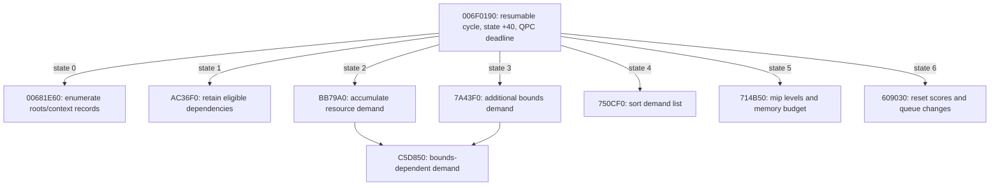

# Native resource-demand cycle: ownership decision and MAIN handoff

Base: latest verified remote integration `63b04ea902f9ee9ea815289457f43f29235ace63`
(`origin/codex/outdoor-frame-bottleneck`), fetched before worktree creation.
Branch: `feature/evolution-native-render-optimization`. Work date: 2026-10-26,
Europe/Warsaw. No repository AGENTS.md at this base; applicable ancestor file empty.
This is independent native-engine work. No renderer/INI changes, game/Steam/XR
execution, installation access, native-image writes, merge or new profiler.

## Engineering decision

**No safe substantial native replacement is admitted.** The new result is a
specific recovered contract, not a repetition of the stereo cost map:
`006F0190 -> AC36F0 -> BB79A0/C5D850` is a resumable resource-demand cycle with
reference retention, camera/bounds-dependent demand, mip-level selection and a
memory budget. It is not established as repeated redundant scene rendering.

The eight inspected cycle bodies account for 553/1141 = **0.484663 ms** of
retained native leaf samples in reference B combat. In the older same-session
indoor/outdoor comparison they rise **0.415254 -> 0.469388 ms**, only **0.054134 ms**;
all native EXE leaves rise **2.823446 -> 3.873469 ms**, or **1.050023 ms**.
Therefore this candidate does not explain most native outdoor growth. These
figures exclude unresolved descendants and are not a hard subsystem ceiling.
There is no demonstrated redundant-operation count and no positive saving bound.

Do not replace the cycle with an object-pointer cache, reduce its frequency,
disable streaming, or omit its reference/priority writes. The apparent repeated
work has observable consequences even when the same material pointer recurs.
No C++ optimization or configuration candidate was manufactured to fill a quota.

## New control-flow and ownership findings

Read-only, noanalysis Ghidra exports use the existing RootCause project with
EXE SHA256 `d46bb6cb762732b72ab9d34428237d2afa89f5792bdbed957d78793ee8134ec1`.
All exports end in EVIDENCE COMPLETE. An older 55c8... EXE was encountered during
inventory and excluded; control strings were rechecked against the pinned EXE.
Names below describe dataflow, not recovered original symbols or certified ABIs.

- `C91330` initializes the object and installs vtable `00FF8CE0`; its slot +68
  holds `006F0190`. Destructor `42A0F0` uses that table and releases owned lists.
  This proves a static type relationship, not the runtime receiver identity.
- `006F0190` uses receiver +40 as states 0..6. Calls at `006F03F2` and `006F043A`
  use the QPC import at `00EEB35C`; high/low comparisons against the supplied
  deadline can exit before the cycle completes. One invocation is NOT necessarily
  one frame or one complete traversal. Mode 3 takes a separate reset path.
- `00681E60` walks source records (stride 20 hex), builds pairs in +F8/+FC/+100,
  invokes a provider virtual +8C and retains handles. Exact provider class,
  mutation epoch and whether these are all active views remain unresolved.
- `AC36F0` collects eligible handles into blocks (+800 cursor/+808 predecessor,
  owner +208/+20C and count +210). Eligibility inspects pointee +F0 then byte +8.
  It calls provider virtual +64 to enumerate dependencies. Every appended handle
  increments its +4 reference count. The stage-2 consumer decrements counts and
  can invoke destruction (`402550`) when combined counts reach zero.
- `BB79A0` and `C5D850` already avoid duplicate demand-list insertion via bit 0
  at resource +44. They still update the maximum demand score at +48. C5D850
  combines bounds-distance, per-part data, optional overrides and dependency
  state; equal object pointers do not imply equal scores or dependency results.
- `714B50` transforms the demand through log2/rounding into a level at +45,
  accounts byte budgets and can lower requests until receiver +48 <= +44.
  `SpeculativeTextureStreaming` gates a further pass at `005AD6B0` when spare
  budget exists. This connects the cycle to texture residency/streaming, rather
  than proving a geometry LOD skip opportunity.
- `609030` explicitly zeroes the score at resource +48 (`60905F/62/65`), compares
  +45/+46, queues changed references at owner +228/+22C, updates +46 and may
  clear +44 bit 0/remove the item when +45 equals +54. Cross-cycle demand must be
  rebuilt even for an unchanged material; retaining only yesterday's seen-set
  loses the new demand after this reset.

Static control-flow entry to the COMPLETE game frame is still unresolved.
Native caller `0099230C -> 00776DC0` is present as an xref, but Ghidra has no
containing analyzed function for that caller. No invented function boundary was
created. `00776DC0` and `BEEBA0` use the streaming owner/provider at +670; that is
not yet a proved dispatch to the particular `00FF8CE0` receiver above. The retained
native stack summaries have UNKNOWN recovered ancestry for all 2478 distinct
B-combat native PCs. A full ordered update-to-render graph cannot honestly be
reconstructed from those leaf samples alone.

## Native execution map: confirmed versus unknown

[Derived machine-readable costs](native-resource-cycle-costs.json) retains exact
weights, denominators, source/export hashes and extraction caveats. The auditor
matches only instruction addresses inside exported analyzed function bodies;
unknown native samples remain unclassified rather than assigned to nearby code.

- Gameplay simulation: `5969E0 -> 9F2030` traverses intrusive children and invokes
  virtual +DC, with flag writes. B leaf 9F2030 = .051709 ms. Concrete child types,
  inclusive simulation cost and per-frame invocation counts are UNKNOWN.
- Scene traversal/visibility/frustum/occlusion: `985D80` consumes the registered
  occlusion flag, but active widened VR view ownership and both-eye rejection
  equivalence are unproved. No measured full visibility subsystem total.
- LOD: candidate BB79A0/C5D850 now has concrete resource-demand consumers. Do not
  relabel all of its .255916 ms B leaf sum as geometry LOD or pure visibility.
- Animation/skinning: existing current-EXE evidence identifies pose-slot rotation,
  skin dirty flags and pack paths (`docs/investigations/darkness2-root-cause.md`).
  Their complete cost/ordering is UNKNOWN; no hand/tentacle or dirty-state edits.
- Material updates: `71F690` already compares owner/dirty ranges before dispatching
  `571670` / `AD3380`; own B leaf .007011 ms. Dirty state is not always redundant.
- Dynamic lighting/shadow preparation: no complete attributable native group or
  proof of eye-independent eligibility. No skipping or aggressive culling.
- Streaming/residency: eight-body cycle above .484663 ms B; call frequency and
  inclusive kernel/allocator descendants UNKNOWN. Samples observed on render
  TID28400 do not prove exclusive thread ownership of the data structures.
- Draw-list generation: not completely recovered. `750CF0` is a sort in the
  resource cycle; it must not be renamed a draw-list sort. Zero retained samples
  in this body do not establish zero work.
- D3D producer submission: BF27A0 shadows sampler values before calling setters;
  own B leaf .062226 ms. 6EE720 is a capacity/alignment and retrying buffer-lock
  path, .000876 ms; no lock/flag removal. These are not full driver costs.
- Native total: 4209/1141 = 3.688869 ms nominal leaf exposure versus scheduled
  render RUN15.73932. Remaining native and downstream system-service ownership
  is unresolved. No allocation of all kernel/runtime costs to this engine cycle.

The older indoor/outdoor trace has 1,026,324 lost events overall; known notices
outside these phases do not certify losslessness. The B reference reports zero
ETW loss but retains UNKNOWN PresentMon process exit. Its raw denominator1141
is intentional (sample aggregation), not the1140 wholly contained scheduler
frames. Cross-session values are never subtracted to claim an optimization.

## Actual 2012 controls and external research

The pinned binary registers these names under Graphics, with native consumers:

- `SpeculativeTextureStreaming`: initializer EC43C0, storage0110E2B4, initial1;
  read at714D10 gates5AD6B0 only after demand/budget work. Turning it off does not
  remove AC36F0/BB79A0/C5D850 and can change future residency/stalls.
- `LimitTextureStreaming`: EC4400, storage0110E2E0, initial0; read by714B50 and
  5AD6B0 selects a level limit. It is not a verified CPU-work budget control.
- `EnableTextureStreaming`: EC4540, storage0110E3F0, initial1; consumed by
  B26D30/BEEBA0/A88EA0/7AA240. A88EA0 switches mode+6F8 to4 and returns when off;
  proving that branch is not proof that every asset is resident or every loading
  transition remains correct. Do not ship a disable flag as a safe efficiency fix.
- `EnableOcclusionQuery`: storage010E3790 consumed at986467 in985D80; no proved
  conservative VR visibility contract. `EnableMaterialLOD` has a registration
  atEA7620; no direct read of its expected value field was found in the current
  analyzed references. Registration alone is not proof of an active optimization.

These are static initializer defaults, NOT measured effective runtime settings.
The existing Lua OptionsDisplayCustomize path exposes texture/shadow quality,
VSync, decals and display mode via Get/SetCustomDisplaySettings. It does not
establish a callable external API to own the native resource cycle.

References inspected (no source/assets copied into Git):
- [TheDarknessIIDecompiled](https://github.com/FromDarkHell/TheDarknessIIDecompiled),
  local850381e0: actual src/D2/Menus/OptionsDisplayCustomize.lua and README.
  Lua/Flash recovery; no native resource-cache implementation. Repacking is not
  established as a safe integration path.
- [LotusLib](https://github.com/Puxtril/LotusLib), locala94f2bd0:
  src/CachePair.cpp reads/seeks cache files and dispatches decompressEE versus
  pre/post Warframe decompression. These are asset readers, not native dirty-state
  or rendering contracts. [Warframe-Exporter](https://github.com/Puxtril/Warframe-Exporter)
  local845faf23 builds on them; no compatible replacement renderer was found.
- [Digital Extremes' Warframe update notes](https://forums.warframe.com/topic/1239775-nsw-deimos-arcana-update-2955/)
  mention streaming optimizations/fixes in a much later revision. They supply
  no 2012-compatible implementation, ABI or configuration guarantee.
- The Dark Sector community configuration route concerns display/aspect settings;
  no verified native cache/dirty-generation replacement was found. Contemporary
  engine lineage and performance anecdotes do not establish binary equivalence.

No modern Warframe variable, unsupported launch command, FOV change, lower
shadow/texture quality, residency bypass or 60 FPS-cap assumption was adopted.

## Best prospective replacement and exact missing contract

Most plausible candidate: **cache the provider's dependency adjacency per
resource-generation and view-context epoch**, while STILL recomputing demand,
maintaining references, budget decisions and the native phase machine.
This is a proposed boundary, not an implemented or admitted hook.

Required inputs: concrete provider identity for AC36F0's virtual +64, root handle
and generation, view/context identity, dependency mutation generation and cycle
identity. Output: an ordered retained dependency list with the same eligibility
and reference semantics as the provider. Cache ownership must retain exact native
handles, invalidate before destruction/replacement and preserve mode3/reset.
A miss or unknown epoch must execute the original provider unchanged. The merge
of per-context demand must still reach the native max-score and budget logic.
No safe external interception or invalidation interface is currently established.

Why not implement now: existing code already deduplicates demand-list insertion;
we have no proof that provider enumeration repeats an identical adjacency set,
no duplicate frequency, no invalidation producer and no runtime concrete receiver.
The apparent redundant work is NOT demonstrated unnecessary. Disabling or caching
whole objects would skip required score recomputation after609030 and can change
mips/residency; aggressive culling can also lose peripheral/tentacle/shadow work.

Smallest next evidence, rather than a general profiler:
1. Resolve ONE concrete provider vtable used at AC36F0 +64 and its implementation,
   including the mutation/destruction sites for the returned dependency sequence.
   A private same-cycle receiver/vtable/root-generation receipt or existing dump
   would select the correct static branch; no guessed vtable replacement.
2. For that provider, establish the native cycle boundary from state+40 and the
   mode/deadline arguments. Record two occurrences of the same root/context and
   their ordered dependency identities, changed bits, +48 demand inputs and ref
   deltas. Samples alone do not supply invocation frequency or equivalence.
3. Only if identical adjacency repeats without mutations, prototype a bounded
   owned cache at a verified non-image interface, then compare original/cached
   ordered outputs, final scores, level requests, reference balances, cancellation
   and allocation failures. No full-runtime replacement until this contract holds.

Benefit bounds: 0 ms is the only demonstrated saving. Even removing ALL selected
cycle-body leaf exposure would account for .485 ms (~7.5% of6.439ms deficit), an
unrealistic body-only scenario, not a hard bound on descendants or predicted FPS.
A dependency cache saves only part of that cycle and adds lookup/retention cost.
No measured basis for a multi-ms optimization was established. A timing/pacing
change that spreads the same work into later frames is not CPU-work removal.

## Deliverables, validation and rollback

New code is only `tools/native-engine/audit_resource_cycle.py` and its unit tests:
read-only hash-gated machine-code checks for six direct edges, vtable slot, demand
writes/reset, QPC calls/import and three control registrations/default writes;
it joins existing sample JSON to exact exported instruction addresses. It is a
narrow evidence auditor, not a new profiler or native optimization.

PASS: actual pinned EXE static audit; three retained-phase joins;10 auditor
admission/parser tests (wrong image/export, incomplete/conflicting owners,
unknown costs, wrong phase/thread/count, failed extraction, negative weights and output-over-input protection).
PASS: existing x86/O2 `build-native-image-guard.ps1` against actual guard source.
No C++/INI/renderer source difference from63b04ea. Full DLL rebuild is not needed
for this tools/documentation-only change; no newly built renderer is delivered.
NOT RUN: native replacement actual-source equivalence (no replacement admitted),
Steam/PSVR2, runtime settings, game performance A/B, visual/stability acceptance.

Private exports and logs: TEMP/d2vr-native-contract-side. Committed JSON contains
only sanitized derived counts/addresses/hashes, never decompiled game bodies,
binaries or ETL data. Reproduction instructions: `tools/native-engine/README.md`.

MAIN handoff: no native candidate to integrate and no driver/replay changes to
cherry-pick. Use this contract to reject object-pointer-only reuse at the producer
boundary. Leave all runtime defaults intact. Branch commit SHA is supplied in the
chat handoff; `git log -1 --format=%H -- docs/research/native-resource-cycle.md`
identifies the report commit. Rollback: no installed/runtime change exists;
remove/revert only these research artifacts if unwanted. Runtime performance
impact of this branch is zero. No automatic game test or merge is requested.
